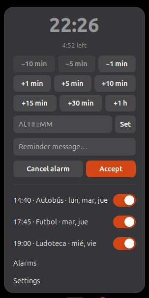

# Alarma Recordatorio

*[Read in English](README.md)*

Cuenta atrás y alarmas en la barra superior de GNOME Shell.



## Qué hace

- **Cuenta atrás** desde el menú: suma o resta minutos con un clic (+1, +5, +10, +15, +30,
  +1 h, −1, −5, −10 por defecto) o fija una hora. Escribe un mensaje y lo verás cuando llegue
  la hora.
- **Alarmas** como las del Reloj de GNOME: hora, días de la semana (o una sola vez), nombre,
  sonido propio, cuánto tiempo suena y cuánto se pospone. Cada una se activa o desactiva desde
  el menú.
- **La barra superior** muestra la hora de la próxima alarma, solo si es hoy, o el tiempo que
  queda de la cuenta atrás, o solo el icono.
- **Avisos** en una ventana con *Posponer*, un mensaje en pantalla que se desvanece o una
  notificación del sistema que se ve también con «No molestar». Sonido con repetición opcional.
- **Sobrevive al bloqueo de pantalla, la suspensión y los reinicios.** Si algo sonó con la
  pantalla bloqueada, lo verás al volver, con cuánto hace.
- Funciona sin conexión y no recoge ningún dato. En español e inglés.

Inspirada en [Reminder Alarm Clock](https://extensions.gnome.org/extension/2482/reminder-alarm-clock/),
cuya última versión llega hasta GNOME 48. Esta es una extensión nueva, escrita desde cero para
GNOME 50.

## Requisitos

GNOME Shell 50.

## Instalación

### Desde Extensiones de GNOME

Busca **Alarma Recordatorio** en [extensions.gnome.org](https://extensions.gnome.org) o en la app
Gestor de extensiones y actívala.

### Desde una versión publicada

Descarga `alarma-recordatorio@galianet.es.shell-extension.zip` de
[Releases](https://github.com/galianet/alarma-recordatorio/releases) y ejecuta:

```bash
gnome-extensions install --force alarma-recordatorio@galianet.es.shell-extension.zip
```

Cierra sesión y vuelve a entrar (en Wayland, GNOME Shell solo carga extensiones nuevas al
iniciar sesión) y después:

```bash
gnome-extensions enable alarma-recordatorio@galianet.es
```

### Desde el código

Necesitas `gnome-extensions` (viene con GNOME Shell) y `msgfmt` (paquete `gettext`).

```bash
git clone https://github.com/galianet/alarma-recordatorio.git
cd alarma-recordatorio
./build.sh --install
```

Después cierra sesión, vuelve a entrar y actívala como arriba.

## Uso rápido

1. Pulsa el despertador de la barra superior.
2. Para un aviso rápido, pulsa un botón de minutos (o escribe una hora en **A las HH:MM**),
   escribe el mensaje y pulsa **Aceptar**.
3. Para alarmas que se repiten, pulsa **Alarmas** y luego **+**.

La [guía de uso](docs/GUIA_DE_USO.md) lo explica todo en detalle: cada opción, qué pasa con la
pantalla bloqueada y soluciones a problemas frecuentes.

## Traducciones

Las traducciones están en `po/`. Para añadir un idioma, copia `po/es.po` como
`po/<código de idioma>.po` (por ejemplo `po/fr.po`), traduce cada `msgstr` y envía un pull
request. `build.sh` las compila.

## Desarrollo

```bash
# GNOME Shell anidado en una ventana, para probar sin cerrar sesión
# (necesita mutter-devkit; Ubuntu/Debian: sudo apt install mutter-dev-bin)
dbus-run-session gnome-shell --devkit --wayland

# Registros
journalctl -f -o cat /usr/bin/gnome-shell   # extensión
journalctl -f -o cat /usr/bin/gjs           # ventana de preferencias
```

| Archivo | Para qué sirve |
|---|---|
| `src/extension.js` | `enable()` / `disable()`; une las piezas |
| `src/controller.js` | Lógica sin interfaz: cuenta atrás, alarmas, posponer, avisos perdidos |
| `src/indicator.js` | Botón de la barra superior y menú |
| `src/reminder.js` | Ventana, mensaje en pantalla, notificación y sonido |
| `src/prefs.js` | Ventanas de Alarmas y Preferencias (libadwaita) |
| `src/utils.js` | Guardado de alarmas, fechas y textos; lo comparten el Shell y las preferencias |
| `src/schemas/` | Esquema de GSettings |
| `po/` | Traducciones |

Errores e ideas: [issues](https://github.com/galianet/alarma-recordatorio/issues).

## Publicar una versión

1. Sube `version-name` en `src/metadata.json` y apunta los cambios en [CHANGELOG.md](CHANGELOG.md).
2. `./build.sh` crea `dist/alarma-recordatorio@galianet.es.shell-extension.zip`.
3. `./build.sh --upload` lo sube a extensions.gnome.org. Usa `--accept-tos`, es decir, acepta
   las condiciones de <https://extensions.gnome.org/upload/>.
4. Etiqueta la versión y adjunta el zip a una *release* de GitHub.

## Licencia

GPL-2.0 o posterior. Ver [LICENSE](LICENSE).
