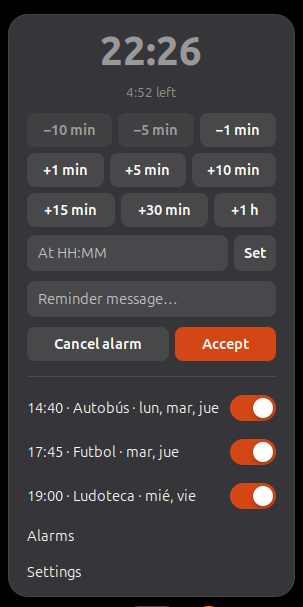

# Alarma Recordatorio

*[Leer en español](LEEME.md)*

Countdown timer and alarm clock in the GNOME Shell top bar.



## Features

- **Countdown** from the menu: add or subtract minutes with one click (+1, +5, +10, +15, +30,
  +1 h, −1, −5, −10 by default), or set a time of day. Write a message and it is shown when the
  time is up.
- **Alarms** like GNOME Clocks: time of day, days of the week (or just once), name, own sound,
  how long it rings and how long Snooze postpones it. Each one can be switched on or off from
  the menu.
- **Top bar** shows the time of the next alarm, only if it is today, or the countdown's time
  left, or just the icon.
- **Reminders** as a dialog with *Snooze*, a fading on-screen message, or a system notification
  that also shows in Do Not Disturb. Optional repeating sound.
- **Survives screen locks, suspend and restarts.** Anything that rang while the screen was
  locked is shown when you come back, with how long ago.
- Works offline and collects nothing. English and Spanish.

Inspired by [Reminder Alarm Clock](https://extensions.gnome.org/extension/2482/reminder-alarm-clock/),
whose latest version supports GNOME 46–48. This is a new extension written from scratch for
GNOME 50.

## Requirements

GNOME Shell 50.

## Installation

### From GNOME Extensions

Search for **Alarma Recordatorio** on [extensions.gnome.org](https://extensions.gnome.org) or in
the Extension Manager app, and switch it on.

### From a release

Download `alarma-recordatorio@galianet.es.shell-extension.zip` from
[Releases](https://github.com/galianet/alarma-recordatorio/releases) and run:

```bash
gnome-extensions install --force alarma-recordatorio@galianet.es.shell-extension.zip
```

Log out and back in (on Wayland GNOME Shell only loads new extensions at login), then:

```bash
gnome-extensions enable alarma-recordatorio@galianet.es
```

### From source

Needs `gnome-extensions` (comes with GNOME Shell) and `msgfmt` (package `gettext`).

```bash
git clone https://github.com/galianet/alarma-recordatorio.git
cd alarma-recordatorio
./build.sh --install
```

Then log out and back in and enable it as above.

## Usage

1. Click the alarm clock in the top bar.
2. For a quick reminder, click a minute button (or type a time in **At HH:MM**), write a
   message and click **Accept**.
3. For recurring alarms, click **Alarms** and then **+**.

The [user guide](docs/USER_GUIDE.md) covers everything in detail: every option, what happens
with the screen locked, and troubleshooting.

## Translations

Translations live in `po/`. To add a language, copy `po/es.po` to `po/<language code>.po`
(for example `po/fr.po`), translate each `msgstr` and open a pull request. `build.sh` compiles
them.

## Development

```bash
# Nested GNOME Shell in a window, to test without logging out
# (needs mutter-devkit; Ubuntu/Debian: sudo apt install mutter-dev-bin)
dbus-run-session gnome-shell --devkit --wayland

# Logs
journalctl -f -o cat /usr/bin/gnome-shell   # extension
journalctl -f -o cat /usr/bin/gjs           # preferences window
```

| File | Purpose |
|---|---|
| `src/extension.js` | `enable()` / `disable()`; wires the pieces together |
| `src/controller.js` | Alarm logic without UI: countdown, alarms, snooze, missed alarms |
| `src/indicator.js` | Top bar button and menu |
| `src/reminder.js` | Dialog, on-screen message, notification and sound |
| `src/prefs.js` | Alarms and Settings windows (libadwaita) |
| `src/utils.js` | Alarm storage, dates and text helpers, shared by Shell and preferences |
| `src/schemas/` | GSettings schema |
| `po/` | Translations |

Bug reports and ideas: [issues](https://github.com/galianet/alarma-recordatorio/issues).

## Releasing

1. Raise `version-name` in `src/metadata.json` and add the changes to [CHANGELOG.md](CHANGELOG.md).
2. `./build.sh` creates `dist/alarma-recordatorio@galianet.es.shell-extension.zip`.
3. `./build.sh --upload` uploads it to extensions.gnome.org. It passes `--accept-tos`, i.e. it
   accepts the terms shown at <https://extensions.gnome.org/upload/>.
4. Tag the version and attach the zip to a GitHub release.

## License

GPL-2.0-or-later. See [LICENSE](LICENSE).
