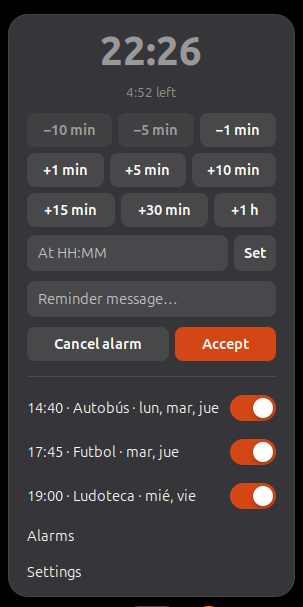
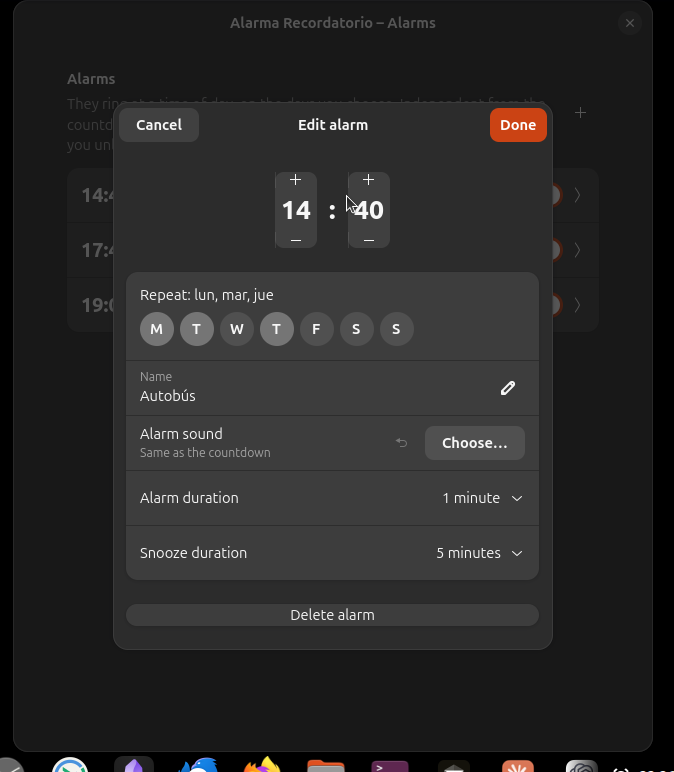
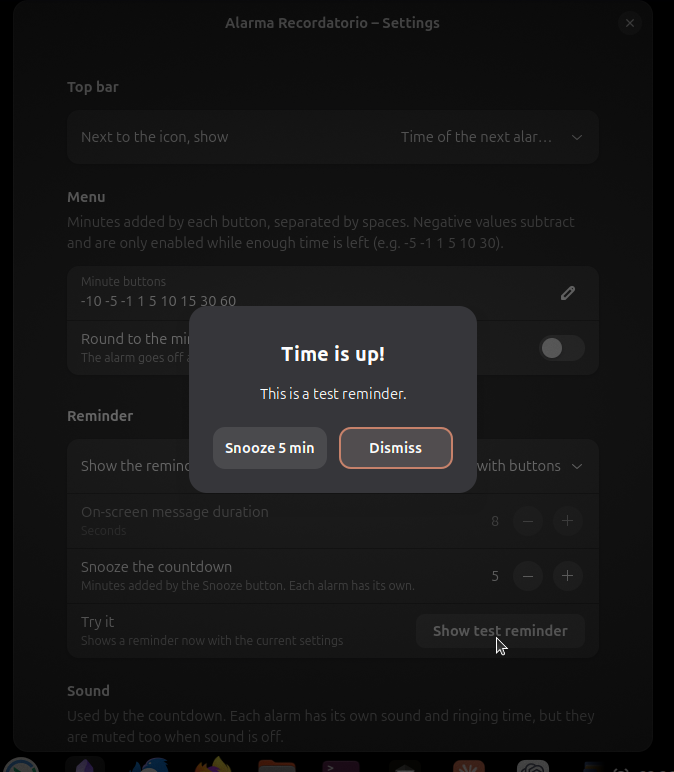

# Guía de uso de Alarma Recordatorio

*[Read in English](USER_GUIDE.md)*

Alarma Recordatorio pone en la barra superior de GNOME dos herramientas:

- **Una cuenta atrás**, para avisos rápidos: «dentro de 10 minutos», «a las 17:30».
- **Alarmas**, como las del Reloj de GNOME: a una hora, los días de la semana que elijas.

Las dos funcionan por separado: puedes tener una cuenta atrás en marcha y varias alarmas
programadas a la vez.

## Índice

1. [El icono de la barra superior](#el-icono-de-la-barra-superior)
2. [El menú](#el-menú)
3. [La cuenta atrás](#la-cuenta-atrás)
4. [Alarmas](#alarmas)
5. [Cuando suena](#cuando-suena)
6. [Pantalla bloqueada, suspensión y reinicios](#pantalla-bloqueada-suspensión-y-reinicios)
7. [Preferencias](#preferencias)
8. [Problemas frecuentes](#problemas-frecuentes)
9. [Desinstalar](#desinstalar)

## El icono de la barra superior



- **Despertador vacío**: no hay nada programado.
- **Despertador relleno**: hay una cuenta atrás en marcha o alguna alarma activada.
- **Hora junto al icono** (`14:35`): cuándo suena lo próximo, sea la cuenta atrás o una alarma,
  **solo si es hoy**. Si lo próximo es mañana o más adelante, solo verás el icono relleno.
  Pasada la medianoche, la alarma de ese día aparece sola.

En [Preferencias](#preferencias) puedes cambiar la hora por el tiempo que queda de la cuenta
atrás, o dejar solo el icono.

## El menú

Pulsa el icono para abrir el menú. Es la pantalla principal de la extensión:

| Parte | Para qué sirve |
|---|---|
| Hora grande | A qué hora termina la cuenta atrás (`--:--` si no hay ninguna) |
| Línea de debajo | Cuánto queda («Quedan 12:34»), con «mañana» delante si termina otro día |
| Botones `−10 min` … `+1 h` | Restar o sumar minutos a la cuenta atrás |
| A las HH:MM / Fijar | Poner la cuenta atrás a una hora concreta |
| Mensaje del recordatorio | El texto que verás cuando suene la cuenta atrás |
| Cancelar alarma | Anula la cuenta atrás (solo aparece si hay una en marcha) |
| Aceptar | Aplica lo que hayas escrito y cierra el menú |
| Interruptores | Uno por alarma, para activarla o desactivarla al momento |
| Alarmas | Abre la ventana de alarmas |
| Preferencias | Abre la ventana de preferencias |

Cuando cierras la ventana de Alarmas o de Preferencias, el menú vuelve a abrirse.

## La cuenta atrás

### Con los botones de minutos

- **Sumar** (`+1 min`, `+5 min`, `+10 min`, `+15 min`, `+30 min`, `+1 h`): si no hay cuenta
  atrás, empieza a contar desde ahora; si la hay, añade los minutos a la que está en marcha.
  Pulsa varios botones seguidos para componer el tiempo: `+30 min` y `+5 min` son 35 minutos.
- **Restar** (`−1 min`, `−5 min`, `−10 min`): quitan minutos a la cuenta atrás. Solo están
  activos cuando queda tiempo suficiente; con 3 minutos por delante, `−1 min` funciona pero
  `−5 min` y `−10 min` aparecen atenuados.

Los botones se pueden cambiar en [Preferencias](#preferencias).

### A una hora concreta

Escribe la hora en el campo **A las HH:MM** y pulsa **Fijar**, Intro o **Aceptar**. Vale
`17:30`, `7:05` o `7.05`. Si esa hora ya ha pasado hoy, la cuenta atrás termina mañana a esa
hora. Si la hora no es válida, el campo se marca en rojo.

### El mensaje

Lo que escribas en **Mensaje del recordatorio** es el título del aviso cuando suene. Si lo
dejas vacío, el aviso dirá «¡Es la hora!». Se guarda al pulsar Intro o **Aceptar**, al cerrar
el menú y al usar cualquier botón de minutos.

## Alarmas

Las alarmas se gestionan desde **Alarmas** en el menú. Cada alarma aparece con su hora, su
nombre, los días en que suena y un interruptor.

### Crear una alarma

1. Pulsa **+** arriba a la derecha.
2. Elige la hora con los selectores (o escríbela).
3. Marca los días en **Repetir**. Si no marcas ninguno, la alarma suena **una sola vez** y
   después se desactiva sola.
4. Opcional: ponle un **Nombre** (es el título del aviso), un **Sonido de alarma** propio,
   cuánto tiempo suena (**Duración de la alarma**) y cuánto se pospone
   (**Duración del retardo**).
5. Pulsa **Hecho**.



### Editar o eliminar

Pulsa sobre la alarma para abrir **Editar alarma**. **Hecho** guarda los cambios y deja la
alarma activada; **Cancelar** los descarta. Abajo del todo está **Eliminar alarma**.

### Activar y desactivar

Con el interruptor de la lista o desde el menú de la barra. Desactivar una alarma también
cancela su posposición, si la tenía.

### Posponer

Al pulsar **Posponer** en el aviso de una alarma, vuelve a sonar pasados los minutos de su
**Duración del retardo**. Mientras tanto, el menú la muestra como «pospuesta hasta las …».
Posponer una alarma no toca la cuenta atrás.

## Cuando suena

### Formas de aviso

Se elige en **Preferencias → Aviso**:



- **Ventana con botones** (por defecto): aparece en el centro de la pantalla con
  **Posponer N min** y **Cerrar**. Se cierra con un clic o con Escape; Intro **no** la cierra,
  para que no la quites sin querer si estabas escribiendo.
- **Mensaje en pantalla que se desvanece**: un aviso grande que desaparece solo pasados unos
  segundos (configurable). Un clic lo quita antes.
- **Notificación del sistema**: una notificación con **Posponer** y **Cerrar**. Se muestra
  aunque tengas activado «No molestar» y no se va hasta que la cierres.

Si al sonar hay otra ventana del sistema en primer plano y no se puede mostrar la ventana del
aviso, llegará como notificación.

Si suenan varias a la vez (por ejemplo, dos alarmas a la misma hora), verás un aviso detrás de
otro, en orden.

### Sonido

- La **cuenta atrás** usa el sonido de **Preferencias → Sonido**: el de alarma del tema de
  sonido del sistema o un archivo que elijas. Puede repetirse cada 6 segundos hasta que cierres
  el aviso, durante 2 minutos como máximo.
- Cada **alarma** usa su propio sonido (o el de la cuenta atrás) y se repite durante su
  **Duración de la alarma**.
- El sonido se detiene al cerrar el aviso.
- **Reproducir un sonido** desactivado silencia todo, también las alarmas.

### Probar

En **Preferencias → Aviso → Probar** pulsa **Mostrar aviso de prueba** para ver y oír un aviso
con la configuración actual.

## Pantalla bloqueada, suspensión y reinicios

GNOME desactiva las extensiones mientras la pantalla está bloqueada. Alarma Recordatorio guarda
todo en la configuración del sistema, así que:

- La cuenta atrás y las alarmas siguen programadas al desbloquear, al suspender el equipo y al
  reiniciar.
- Si algo sonó mientras la pantalla estaba bloqueada o la sesión cerrada, lo verás al volver,
  indicando cuánto hace: «Sonó hace 12 min, con la sesión bloqueada o cerrada».
- Los avisos perdidos muy antiguos no se muestran: más de 24 horas para la cuenta atrás y más de
  12 horas para las alarmas.

## Preferencias

### Barra superior

| Opción | Qué hace |
|---|---|
| Junto al icono, mostrar | **Hora de la próxima alarma, si es hoy** (por defecto), **Tiempo que queda de la cuenta atrás** o **Nada, solo el icono** |

### Menú

| Opción | Qué hace |
|---|---|
| Botones de minutos | Los botones del menú, separados por espacios. Los negativos restan. Hasta 12 valores, cada uno entre −1440 y 1440, sin el 0. Pulsa ✓ para aplicar |
| Redondear al minuto | La cuenta atrás termina en el segundo 00 del minuto |

### Aviso

| Opción | Qué hace |
|---|---|
| Mostrar el aviso como | Ventana con botones, mensaje en pantalla o notificación del sistema |
| Duración del mensaje en pantalla | Segundos que se ve el mensaje en pantalla (de 2 a 60) |
| Posponer la cuenta atrás | Minutos que añade **Posponer** en el aviso de la cuenta atrás. Cada alarma tiene los suyos |
| Probar | Muestra un aviso ahora con la configuración actual |

### Sonido

| Opción | Qué hace |
|---|---|
| Reproducir un sonido | Activa o silencia todos los sonidos |
| Archivo de sonido | Sonido de la cuenta atrás. ↶ vuelve al sonido de alarma del sistema |
| Repetir hasta cerrar el aviso | Repite el sonido de la cuenta atrás cada 6 segundos, 2 minutos como máximo |

## Problemas frecuentes

**He instalado la extensión y no aparece.**
En Wayland, GNOME solo carga extensiones nuevas al iniciar sesión. Cierra sesión, vuelve a
entrar y actívala con la app Extensiones o con
`gnome-extensions enable alarma-recordatorio@galianet.es`.

**Pulso Alarmas o Preferencias y no se abre nada.**
GNOME solo permite una ventana de preferencias de extensiones abierta a la vez. Cierra las
preferencias de cualquier otra extensión y vuelve a intentarlo.

**No suena.**
Comprueba que **Reproducir un sonido** está activado y el volumen del sistema. Si el tema de
sonido del sistema no tiene sonido de alarma, elige un archivo en **Archivo de sonido**.

**El sonido se solapa consigo mismo.**
La repetición vuelve a lanzar el sonido cada 6 segundos. Con archivos largos se superpone: usa
un sonido corto.

**Quiero ver qué está pasando.**
Los mensajes de la extensión salen en el registro de GNOME Shell:

```bash
journalctl -b -o cat /usr/bin/gnome-shell | grep -i -A5 alarma
```

## Desinstalar

Desde la app Extensiones, o con:

```bash
gnome-extensions uninstall alarma-recordatorio@galianet.es
```

Para borrar también toda su configuración (alarmas incluidas):

```bash
dconf reset -f /org/gnome/shell/extensions/alarma-recordatorio/
```
