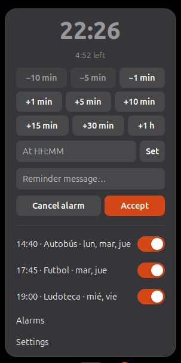
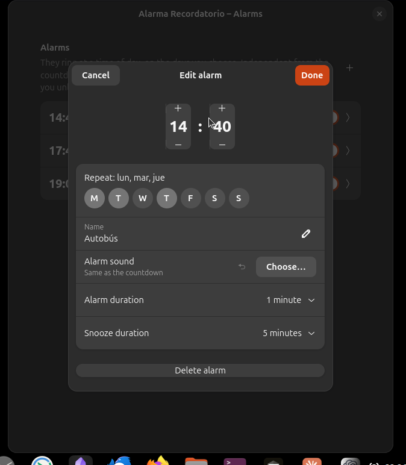
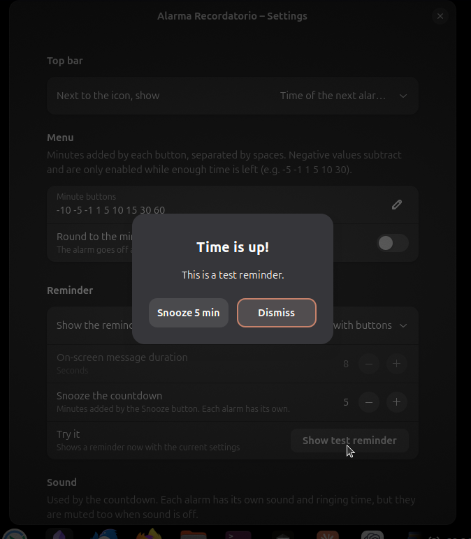

# Alarma Recordatorio user guide

*[Leer en español](GUIA_DE_USO.md)*

Alarma Recordatorio adds two tools to the GNOME top bar:

- **A countdown**, for quick reminders: "in 10 minutes", "at 17:30".
- **Alarms**, like the ones in GNOME Clocks: at a time of day, on the days of the week you
  choose.

They work separately: you can have a countdown running and several alarms set at the same time.

## Contents

1. [The top bar icon](#the-top-bar-icon)
2. [The menu](#the-menu)
3. [The countdown](#the-countdown)
4. [Alarms](#alarms)
5. [When it rings](#when-it-rings)
6. [Screen lock, suspend and restarts](#screen-lock-suspend-and-restarts)
7. [Settings](#settings)
8. [Troubleshooting](#troubleshooting)
9. [Uninstalling](#uninstalling)

## The top bar icon



- **Empty alarm clock**: nothing is set.
- **Filled alarm clock**: a countdown is running or an alarm is on.
- **Time next to the icon** (`14:35`): when the next thing rings, countdown or alarm, **only if
  it is today**. If the next one is tomorrow or later, you only see the filled icon. After
  midnight, that day's alarm shows up on its own.

In [Settings](#settings) you can show the countdown's time left instead, or only the icon.

## The menu

Click the icon to open the menu. It is the main screen of the extension:

| Part | What it is for |
|---|---|
| Big time | When the countdown ends (`--:--` if there is none) |
| Line below | Time left ("12:34 left"), with "tomorrow" in front if it ends another day |
| `−10 min` … `+1 h` buttons | Subtract or add minutes to the countdown |
| At HH:MM / Set | Set the countdown to a time of day |
| Reminder message | The text you will see when the countdown rings |
| Cancel alarm | Cancels the countdown (only shown while one is running) |
| Accept | Applies what you typed and closes the menu |
| Switches | One per alarm, to turn it on or off right away |
| Alarms | Opens the alarms window |
| Settings | Opens the settings window |

When you close the Alarms or Settings window, the menu opens again.

## The countdown

### With the minute buttons

- **Add** (`+1 min`, `+5 min`, `+10 min`, `+15 min`, `+30 min`, `+1 h`): with no countdown it
  starts counting from now; with one running, it adds the minutes to it. Click several buttons
  to build up the time: `+30 min` then `+5 min` makes 35 minutes.
- **Subtract** (`−1 min`, `−5 min`, `−10 min`): take minutes off the countdown. They are only
  enabled while enough time is left; with 3 minutes to go, `−1 min` works but `−5 min` and
  `−10 min` are dimmed.

The buttons can be changed in [Settings](#settings).

### At a time of day

Type the time in **At HH:MM** and press **Set**, Enter or **Accept**. `17:30`, `7:05` and
`7.05` all work. If that time has already passed today, the countdown ends at that time
tomorrow. An invalid time turns the field red.

### The message

Whatever you type in **Reminder message** becomes the title of the reminder. Left empty, the
reminder says "Time is up!". It is saved when you press Enter or **Accept**, when the menu
closes and when you use any minute button.

## Alarms

Alarms are managed from **Alarms** in the menu. Each one is listed with its time, name, the
days it rings and a switch.

### Adding an alarm

1. Click **+** at the top right.
2. Pick the time with the spin buttons (or type it).
3. Choose the days under **Repeat**. With no day selected the alarm rings **once** and then
   switches itself off.
4. Optionally give it a **Name** (the reminder title), its own **Alarm sound**, how long it
   rings (**Alarm duration**) and how long it is postponed (**Snooze duration**).
5. Click **Done**.



### Editing or deleting

Click an alarm to open **Edit alarm**. **Done** saves the changes and turns the alarm on;
**Cancel** discards them. **Delete alarm** is at the bottom.

### Turning alarms on and off

Use the switch in the list or in the top bar menu. Turning an alarm off also cancels its
snooze, if any.

### Snooze

Clicking **Snooze** on an alarm's reminder makes it ring again after its **Snooze duration**.
Meanwhile the menu shows it as "snoozed until …". Snoozing an alarm does not touch the
countdown.

## When it rings

### Kinds of reminder

Chosen in **Settings → Reminder**:



- **Dialog with buttons** (default): shows up in the middle of the screen with
  **Snooze N min** and **Dismiss**. It closes with a click or with Escape; Enter does **not**
  close it, so you do not dismiss it by accident while typing.
- **On-screen message that fades out**: a large message that goes away by itself after a few
  seconds (configurable). A click removes it sooner.
- **System notification**: a notification with **Snooze** and **Dismiss**. It is shown even in
  Do Not Disturb and stays until you close it.

If another system dialog is in front when it rings and the reminder dialog cannot be shown, it
arrives as a notification instead.

When several ring at once (two alarms at the same time, for example), you see one reminder after
the other, in order.

### Sound

- The **countdown** uses the sound in **Settings → Sound**: the alarm sound of the system sound
  theme, or a file you choose. It can repeat every 6 seconds until you dismiss the reminder, for
  2 minutes at most.
- Each **alarm** uses its own sound (or the countdown's) and repeats for its
  **Alarm duration**.
- The sound stops when the reminder is dismissed.
- Turning **Play a sound** off mutes everything, alarms included.

### Trying it

In **Settings → Reminder → Try it**, click **Show test reminder** to see and hear a reminder with
the current settings.

## Screen lock, suspend and restarts

GNOME disables extensions while the screen is locked. Alarma Recordatorio stores everything in
the system settings, so:

- The countdown and the alarms stay set across screen locks, suspend and restarts.
- If something rang while the screen was locked or the session was closed, you see it when you
  come back, with how long ago: "It went off 12 min ago, while the session was locked or
  closed".
- Very old missed reminders are not shown: more than 24 hours for the countdown and more than
  12 hours for alarms.

## Settings

### Top bar

| Option | What it does |
|---|---|
| Next to the icon, show | **Time of the next alarm, if it is today** (default), **Time left on the countdown** or **Nothing, only the icon** |

### Menu

| Option | What it does |
|---|---|
| Minute buttons | The menu buttons, separated by spaces. Negative values subtract. Up to 12 values, each between −1440 and 1440, not 0. Click ✓ to apply |
| Round to the minute | The countdown ends at second 00 of the minute |

### Reminder

| Option | What it does |
|---|---|
| Show the reminder as | Dialog with buttons, on-screen message or system notification |
| On-screen message duration | Seconds the on-screen message stays (2 to 60) |
| Snooze the countdown | Minutes added by **Snooze** on the countdown's reminder. Each alarm has its own |
| Try it | Shows a reminder now with the current settings |

### Sound

| Option | What it does |
|---|---|
| Play a sound | Turns all sounds on or off |
| Sound file | The countdown's sound. ↶ goes back to the system alarm sound |
| Repeat until dismissed | Repeats the countdown's sound every 6 seconds, for 2 minutes at most |

## Troubleshooting

**I installed the extension and it does not show up.**
On Wayland, GNOME only loads new extensions when you log in. Log out, log back in and enable it
with the Extensions app or with `gnome-extensions enable alarma-recordatorio@galianet.es`.

**Clicking Alarms or Settings opens nothing.**
GNOME allows only one extension preferences window at a time. Close the preferences of any other
extension and try again.

**There is no sound.**
Check that **Play a sound** is on and the system volume. If the system sound theme has no alarm
sound, choose a file in **Sound file**.

**The sound overlaps with itself.**
Repeating plays the sound again every 6 seconds; long files overlap. Use a short sound.

**I want to see what is going on.**
The extension logs to the GNOME Shell journal:

```bash
journalctl -b -o cat /usr/bin/gnome-shell | grep -i -A5 alarma
```

## Uninstalling

From the Extensions app, or with:

```bash
gnome-extensions uninstall alarma-recordatorio@galianet.es
```

To also remove all its settings (alarms included):

```bash
dconf reset -f /org/gnome/shell/extensions/alarma-recordatorio/
```
